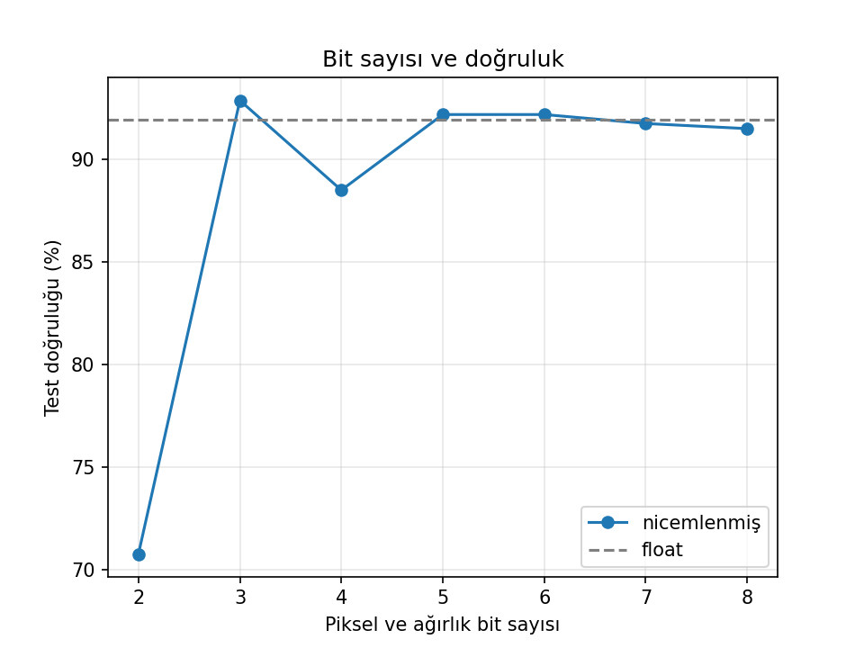

# ttl-8bit-mac

**English** | [Türkçe](README.tr.md)

A hardware multiply-accumulate (MAC) accelerator for an 8-bit computer built on breadboards from discrete TTL logic chips. The MAC units are added to the CPU as an instruction set extension (`MAC`, `CLRACC`, `RDACC`), and three ways of implementing MAC are compared by clock cycles, hardware cost (chip count) and classification accuracy.

This repository holds the preliminary work for a TÜBİTAK 2209-A research proposal and, later, the project outputs.

## Research question

How do the **implementation method** of the MAC unit (software, shift-and-add hardware, EEPROM lookup table), its **degree of parallelism** (1 or 2 units) and the **data bit width** (2–8 bits) trade off **end-to-end cycle count**, **hardware cost** and **classification accuracy** on a fixed workload?

## Benchmark task: 5×5 colour classification

- Each of the 25 pixels has a 4-bit R, G and B value.
- Every pixel is assigned to one of 4 classes (red, green, blue, yellow) by a linear classifier, a single-layer neural network: `score_k = w_k1·R + w_k2·G + w_k3·B + b_k`. The highest score wins.
- Weights are signed 4-bit integers; the accumulator is 12 bits.
- The CPU counts the colours and lights the LED of the most frequent one.
- One image needs **300 MAC operations** (25 pixels × 4 classes × 3 channels).

The task is not the goal in itself; it is a fixed benchmark that makes the MAC architecture visible and measurable.

## Preliminary results (2026-10-20, synthetic data)

| Measurement | Result |
|---|---|
| Test accuracy, floating point | 91.9% |
| Test accuracy, 4-bit | 88.5% |
| 5×5 scene test | 11 / 12 correct LEDs |
| Accumulator range | −92 … +91 |

The data is synthetic and the test set is small, so these numbers may shift by a few points. Details: [pre-training/](pre-training/)



## Train the model on your own images

You can reproduce the results or train the model on data you create yourself. There are two ways:

**A. Generate synthetic images with the data generator**
1. Open [tools/data-generator/index.html](tools/data-generator/index.html) in your browser (download it and double-click it), or use the online version: https://yazzsshn.github.io/ttl-8bit-mac/tools/data-generator/
2. Choose the number of training images per colour, image size, tone variety and the number of 5×5 test scenes.
3. Press **foto.zip indir** (download foto.zip).

**B. Use your own photos**
Take photos of red, green, blue and yellow objects and name them like this (Turkish or English colour names both work):
- Training images: `red_1.jpg`, `red_2.jpg`, `green_1.png`, `blue_1.png`, `yellow_1.png` … (at least 2 per colour, 5 or more recommended; the last image of each colour is held out for testing)
- Test scenes: names start with `test` or `sahne` and end with the dominant colour, e.g. `test_01_blue.png`

Put all of them into one `foto.zip`.

**Then train:**
1. Open [pre-training/renk_on_deneme.ipynb](pre-training/renk_on_deneme.ipynb) in Google Colab (File → Upload notebook).
2. Run the cells in order. When the upload button appears, choose your `foto.zip`.
3. The notebook trains the model, quantises it to 4 bits, simulates the hardware MAC loop step by step, sweeps bit widths from 2 to 8, tests the 5×5 scenes and finally writes `mac_test.txt`, the test table for the Digital simulation.

## Repository layout

```
ttl-8bit-mac/
├── README.md / README.tr.md
├── LICENSE                     Apache License 2.0
├── tools/
│   └── data-generator/         browser page that generates synthetic training images and test scenes
├── pre-training/
│   ├── renk_on_deneme.ipynb    model, 4-bit quantisation, MAC loop, bit sweep, test-table export
│   ├── data/                   foto.zip used for the published results
│   └── results/2026-10-20/     sonuclar.txt, bit_taramasi.png, sahne_sonuclari.png
├── simulation/                 Digital circuit files (.dig), test tables, ROM contents, screenshots
├── hardware/                   breadboard schematics, microcode, EEPROM images, measurements (during the project)
└── docs/                       lab sheets and teaching material (during the project)
```

## Simulation

Circuits are built in [Digital](https://github.com/hneemann/Digital) (free, runs on Java). Open `simulation/mac_birimi.dig` and press the test button; all 912 rows of `simulation/tests/mac_test.txt` must pass. See [simulation/](simulation/).

## Status

| Part | Status |
|---|---|
| Python model and preliminary results | Done |
| MAC unit in Digital | In progress |
| Full CPU in simulation, breadboard build, parallel MAC | Planned (project period) |

## License

Apache License 2.0. See [LICENSE](LICENSE).
